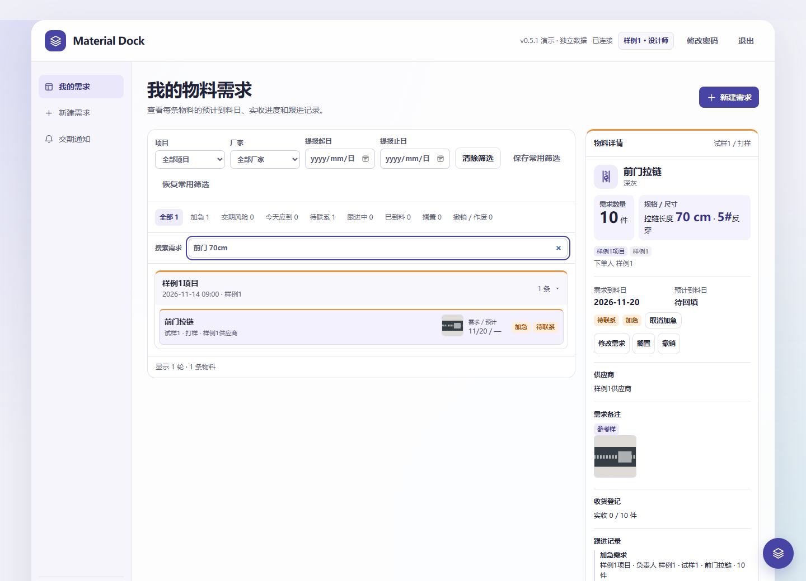

# Material Dock v0.5.1

[English](README.en.md)

## 🧵 这条拉链什么时候到？

设计师把需求表发出去了，接下来还得确认数量有没有改、厂家答应哪天到、Excel 里的参考图对应哪一行。材料员这边，同一项目的几条物料都回了交期，能不能一起更新？

Material Dock 从这些问题长出来。最初是服装设计师用办公室表格和 AI 一边聊一边试的 vibe coding 小项目。参考图对不上，就让图片跟着物料行走。一个项目要反复回填，就加筛选和批量跟进。遇到还没定下来的需求，就让它先搁置，确认后再继续。试到参考图真的出现在对应物料旁边时，颇有点「这回对了」的感觉。:)

设计师在浏览器里提报、调整和查看自己的需求。材料员集中查供应商、跟进交期、登记实收和导出。后台用 Python 和 SQLite。

## 👀 先看工作台



| 想做什么 | 从哪里开始 |
| --- | --- |
| 找一条物料，确认数量、图片和到料日 | [看板、筛选和详情](docs/user-guide.md#看板筛选和详情) |
| 新建需求，导入 Excel 或临时搁置 | [设计师提报和变更](docs/user-guide.md#设计师提报和变更) |
| 给一批物料回交期、代下单或登记实收 | [材料员跟单和收货](docs/user-guide.md#材料员跟单和收货) |
| 导入供应商，录单时快速找厂家 | [供应商库和录单选厂](docs/user-guide.md#供应商库和录单选厂) |
| 看懂颜色、按钮、图标和通知红点 | [状态色和图标](docs/user-guide.md#状态色和图标) · [通知和悬浮快捷入口](docs/user-guide.md#通知和悬浮快捷入口) |
| 让不在办公网的同事访问同一套数据 | [公网部署链路与检查步骤](docs/deployment.md#公网部署链路) |

## 本地试用

需要 Python 3.12。Windows 可在仓库根目录运行以下 PowerShell 命令。

```powershell
py -3.12 -m venv .venv
.\.venv\Scripts\python.exe -m pip install -r requirements.txt
.\.venv\Scripts\python.exe -m pip check
.\.venv\Scripts\python.exe -m unittest discover -s tests -v
.\.venv\Scripts\python.exe demo.py designer
```

macOS 或 Linux 使用 `python3.12 -m venv .venv` 创建环境，将后续命令中的 Python 路径换成 `.venv/bin/python`。

第一次启动自动生成独立演示库和随机初始密码，密码保存在 `demo-data/样例1-登录密码.txt`。三个演示入口共用样例数据。

| 入口 | 命令参数 | 账号 |
| --- | --- | --- |
| `01-设计师演示.cmd` | `demo.py designer` | 样例1 |
| `02-材料员演示.cmd` | `demo.py materials` | 样例3 |
| `03-另一位设计师.cmd` | `demo.py other` | 样例2 |

同时对照两端时使用独立浏览器配置或隐私窗口。给上述命令加 `--no-browser` 可只启动服务，适合自动化验收。演示监听本机回环地址。关闭演示可用进程管理器终止 `demo-data/server.pid` 指定的进程，先核对其命令行为本目录的 `demo.py serve`。

## 各板块文档

| 板块 | 说明 |
| --- | --- |
| 登录、角色、账号初始化 | [账号与权限](docs/accounts.md) |
| 设计师需求、材料员跟单、叠签、搜索、到料 | [工作台与业务状态](docs/workspace.md) |
| Excel、内嵌参考图、附件、导出 | [工作簿与文件](docs/workbooks.md) |
| 供应商模板、预览、去重与需求关联 | [供应商库](docs/suppliers.md) |
| 服务入口、局域网、HTTPS、备份和更新 | [部署与运维](docs/deployment.md) |
| 测试命令、入口和隐私验收 | [验收清单](docs/verification.md) |
| 原生界面模块与图标许可 | [前端说明](web/README.md) |

启动自有数据的实例使用 `manage.py init` 后运行 `server.py`。具体命令和数据位置见部署文档。

## 💬 欢迎提 Issue，也欢迎一起改

哪一步卡住了？你们办公室有更顺的做法？欢迎在 [Issues](https://github.com/pupprise/Material-Dock/issues) 说说你原本想完成什么、页面实际发生了什么。附上脱敏截图或样例 Excel 更容易一起排查。

也欢迎 fork 后提交 commit，再开 [Pull Request](https://github.com/pupprise/Material-Dock/pulls)。改清一句说明、补一个导入测试、少让材料员点一次按钮，都算有价值的改动。顺手说说改动解决了哪个问题就好。
