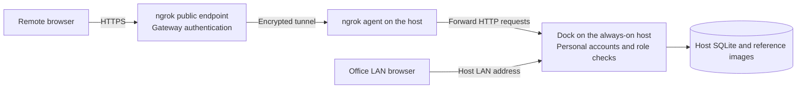

# Deployment and operations

[简体中文](deployment.md) · [Illustrated user guide](user-guide.en.md)

## Start an independent instance

Install dependencies from the repository root as shown in the [README](../README.en.md#run-locally). Then run on Windows:

```powershell
.\.venv\Scripts\python.exe manage.py init --designer 样例1 --designer 样例2 --materials 样例3 --port 8765
.\.venv\Scripts\python.exe server.py
```

The account packages and instructions are generated under `private/`. Open the matching account link and use its generated password. Check `/healthz` and `/versionz` on the host. For background startup, use `start_dock.py --no-browser`; the data directory holds the process ID in `server.pid`.

Use `--interface HOST_IPV4/PREFIX` when initializing a LAN instance. For access across subnets, verify organization routing and the firewall, then add any permitted networks with `--peer-network`.

## Public deployment route



LAN and public access can share one Dock instance. The agent connects out to ngrok using its own host credential. Remote users pass gateway authentication, then sign in with their individual Dock accounts. SQLite and reference photos stay on the host. ngrok terminates public HTTPS in its cloud. [ngrok HTTPS endpoints and authentication](https://ngrok.com/docs/gateway/endpoints/http)

1. Verify the upstream locally. Open the health and version endpoints and log in with an individual account. Use loopback for a public-only instance, or the actual listening LAN address and port when both routes share an instance.
2. Register your complete public HTTPS origin with `--https-origin` during initialization. For an existing instance, update `httpsProxyOrigins` in private `config.json` and restart. Do not include a path or trailing slash. The proxy preserves browser-facing Host and Origin.
3. Configure the agent authtoken and keep the policy and credentials outside the repository. The policy shown in the Chinese guide validates gateway credentials first, then strips the `Authorization` header before forwarding to Dock. Replace all placeholders, use your assigned domain, and match the upstream to Dock's listening address. [Gateway policy example](deployment.md#公网部署链路) · [ngrok Basic Auth example](https://ngrok.com/docs/gateway/endpoints/http#basic-auth-example)

   ```powershell
   ngrok http http://127.0.0.1:8765 --url https://dock.example.com --traffic-policy-file C:\DockPrivate\traffic-policy.yml
   ```

4. Test over a separate network in a private browser window. Verify missing and incorrect gateway credentials are rejected, then sign in and check both roles. To issue a public invitation, replace the address portion with the HTTPS origin and keep the intended recipient's complete invite fragment. Distribute each privately.
5. Keep the host awake and online with both programs running. Visible public pages poll every three minutes, and hidden pages pause polling. Check the ngrok usage dashboard for requests and outbound traffic. [ngrok plan limits and usage](https://ngrok.com/docs/pricing-limits/free-plan-limits)

Gateway prompts concern the gateway credentials. Sign-in errors inside Dock concern the personal account. An offline endpoint calls for a check of the host, running agent, and local health endpoint. A fixed-address error after gateway authentication calls for a check of the registered origin, Host, and Origin.

For updates and backups, keep private configuration, the SQLite database, and the matching `reference-photos/` directory together. Test upgrades and restores on a separate instance before switching the production host. [Chinese operations notes](deployment.md#数据更新与回退)
