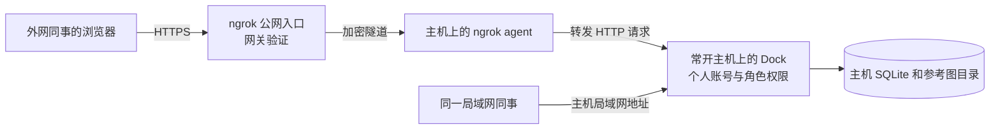

# 部署与运维

[English](deployment.en.md) · [图解使用手册](user-guide.md)

从仓库根目录安装依赖后，按以下示例初始化独立实例。

```powershell
.\.venv\Scripts\python.exe manage.py init --designer 样例1 --designer 样例2 --materials 样例3 --port 8765
.\.venv\Scripts\python.exe server.py
```

浏览器打开 `private/` 中对应账号邀请包里的链接，按说明输入初始化生成的密码。用 `/healthz` 检查连通，用 `/versionz` 检查版本。也可以运行 `start_dock.py --no-browser` 后台启动同一配置，进程编号记录在数据目录的 `server.pid`。

局域网使用 `manage.py init --interface 主机IPv4/前缀`。跨网段需在组织网络内配置路由，按需补充 `--peer-network`，并确认端口放行。

## 公网部署链路



公网和内网最终访问同一个 Dock 实例。ngrok agent 从常开主机主动连到 ngrok 云端，使用自己的主机连接凭据；外网同事使用网关用户名和密码通过入口验证，再用个人 Dock 账号访问数据。数据库和参考图保存在主机，HTTPS 在 ngrok 云端终止。[ngrok HTTPS 代理与验证说明](https://ngrok.com/docs/gateway/endpoints/http)

### 从本机到公网

1. **先跑通上游。** 启动正式实例，从常开主机核对 `/healthz`、`/versionz` 和个人登录。仅从公网访问时，Dock 可监听回环地址；内外网共用时，ngrok agent 转发到 Dock 实际监听的局域网地址和端口。
2. **登记公网域名。** 新部署用 `manage.py init` 的 `--https-origin` 参数，已有实例则更新私有 `config.json` 的 `httpsProxyOrigins` 并重启。填写分配给自己的完整 HTTPS origin，像 `https://dock.example.com`，不带路径或末尾斜杠。代理保留浏览器访问的 Host 和 Origin。
3. **配置网关验证，再启动隧道。** 在 ngrok 配置主机 authtoken，并将策略放在仓库外的私有目录。下面的策略先验证网关凭据，再移除发往 Dock 的 `Authorization` 请求头。将占位凭据换成单独生成的网关用户名和密码。[ngrok Basic Auth 示例](https://ngrok.com/docs/gateway/endpoints/http#basic-auth-example) · [Remove Headers](https://ngrok.com/docs/gateway/traffic-policy/actions/remove-headers)

   ```yaml
   on_http_request:
     - actions:
         - type: basic-auth
           config:
             enforce: true
             credentials:
               - "REPLACE_USERNAME:REPLACE_PASSWORD"
         - type: remove-headers
           config:
             headers: ["authorization"]
   ```

   下方命令使用占位域名和回环上游。若 Dock 实际监听局域网地址，用那个地址替换回环地址。

   ```powershell
   ngrok http http://127.0.0.1:8765 --url https://dock.example.com --traffic-policy-file C:\DockPrivate\traffic-policy.yml
   ```

4. **从外网验收。** 用外网或手机热点在隐私窗口打开公网域名。先测试无凭据或错误凭据会被网关拒绝；用正确网关凭据验证登录页到得了；再用各角色测试数据范围。分发时将个人邀请的地址换成公网 origin，并保留同一个人的完整链接片段。私下交给本人。
5. **检查常开条件。** 主机要保持开机、联网并运行两个程序。公网可见页面每三分钟自动更新，隐藏时暂停；主动提交后会刷新。用 ngrok 控制台观察请求数和出站流量，尤其留意大图、附件和多个页面同时打开的情况。[ngrok 免费套餐和用量入口](https://ngrok.com/docs/pricing-limits/free-plan-limits)

| 现象 | 先查哪里 |
| --- | --- |
| 公网地址打不开或显示入口离线 | 主机电源、网络、ngrok agent 和域名，再查 Dock 本地健康页。 |
| 浏览器反复弹出用户名和密码 | 核对网关凭据。 |
| 登录页提示姓名或密码错误 | 用原个人邀请和当前 Dock 密码。 |
| 网关验证后显示固定地址提示 | 核对 `httpsProxyOrigins`、请求 Host 和浏览器 origin。 |

### 数据、更新与回退

- 本地 `config.json` 指定数据目录。恢复需要私有配置、SQLite 文件和数据路径下的 `reference-photos/`。原图及缩略图由这一目录保存。
- 在停服窗口备份整个数据目录与配置，或者用 SQLite 在线备份 API 获取一致的数据库快照后同步对应原图。恢复先用测试副本验证。
- 升级前在独立端口试跑数据库副本。核对登录、权限、供应商、导入和导出后再切换生产服务。若需使用备份恢复，记录备份之后的写入。
- 内网接入、公网代理、正式账号和业务资料按各自所在环境维护。GitHub 仓库用于交付源码。
