# Material Dock illustrated guide

[简体中文](user-guide.md) · [Home](../README.en.md)

The screenshots use synthetic records from the local v0.5.1 demo. The interface and Excel templates use Simplified Chinese. Button labels below match the interface.

## Sign-in and roles

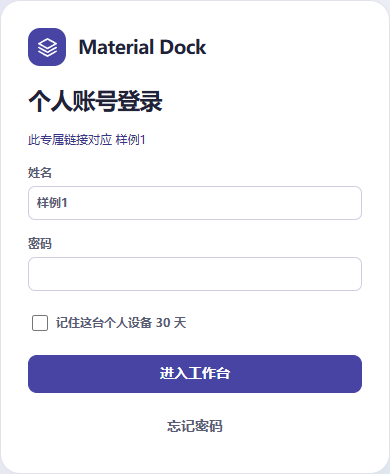

1. Open your personal invite link, check the account name, enter your Dock password, and select **进入工作台**. For the demo password, see [Run locally](../README.en.md#run-locally).
2. A public endpoint can ask for gateway credentials first. After the browser prompt, sign in with your personal Dock account on the page shown above. [Public deployment](deployment.en.md)
3. Enable **记住这台个人设备 30 天** on your own device if desired. On a shared workstation, select **退出** when finished. For password recovery, open the original personal invite and select **忘记密码**.

Designers have My Requests, New Request, and Delivery Notices in their sidebar. They see their own records and attachments. The materials coordinator has the Tracking Board, Order on Behalf, Supplier Directory, and Delivery Notices, with access to the shared tracking queue.

## Board, filters, and details

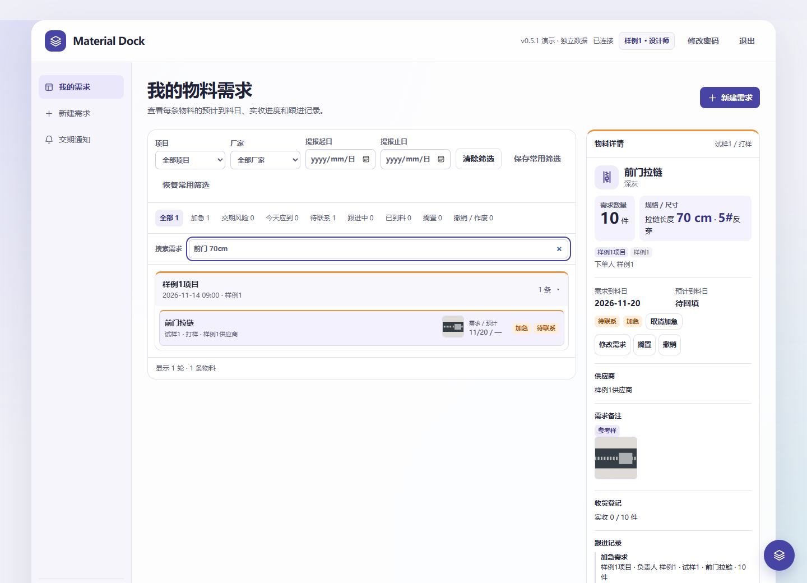

| Area | How to use it |
| --- | --- |
| Top bar | Check the version, account, and role. **已连接** means the workspace last loaded successfully. **离线 · 上次结果** shows the last loaded data. Password change and sign-out are on the right. |
| Sidebar | Purple highlighting marks the current view. The desktop layout places the request list beside the details panel. |
| Filters | Narrow by project, supplier, or submission dates. The coordinator can also filter by requester. Use **保存常用筛选** and **恢复常用筛选** to save and restore one combination in the current browser. **清除筛选** resets it. |
| Status and search | Filter risks, items due today, in-progress items, completed items, or archived records. Due Today uses the expected date when available, otherwise the requested date. Combine keywords such as `前门 70cm` with other filters. |
| Request cards and rows | A workbook submission forms one group, as does a single manual request. The card heading shows project, submission time, requester, and the matching item count. Toggle the group to expand or collapse it. Select a material name for details or its thumbnail for the original image. |
| Details | Start with quantity, unit, and dimensions. Below those are ownership, requested and expected dates, supplier, notes, files, receipts, source worksheet row, and the activity timeline. |

## Designer requests

### Submit one request

Open **新建需求**. Use **快速录入** to fill the form, **粘贴一行** to paste one Excel row in the displayed column order, or **填入测试物料** to explore the form.

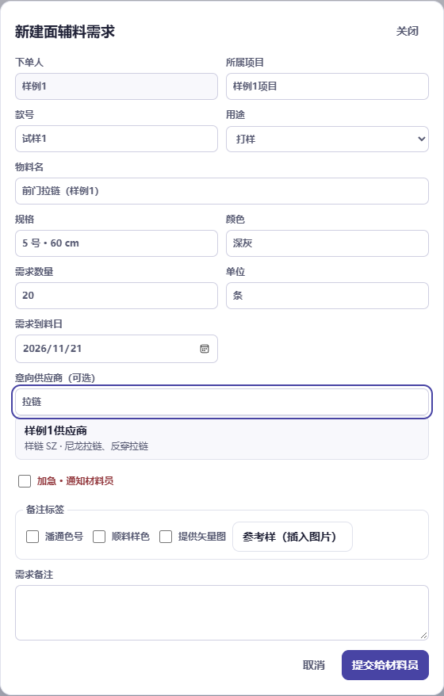

1. Enter the project, style, purpose, material name, quantity, unit, and requested date. Dock fills the requester from the signed-in account.
2. Add specifications and color as needed. Look up a preferred supplier by name, alias, or product category, or type a name outside the directory.
3. Mark urgent requests with **加急 · 通知材料员**. Add Pantone, sample-color, artwork, or reference-image information as needed.
4. Select **提交给材料员** and return to **我的需求** to track progress.

### Import a workbook

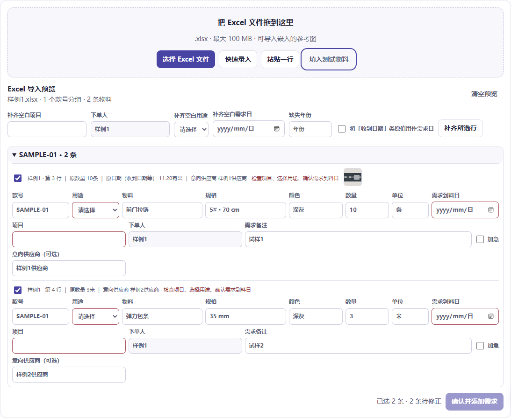

1. Drop or select one `.xlsx` up to 100 MB. Each batch accepts up to 1,000 lines.
2. Review the worksheet, source row, original quantity, and thumbnail. Deselect any rows you want to leave out. If a referenced image is missing or linked externally, embed the image in the workbook and upload again. Rows with no reference image can be submitted.
3. For shared blank fields, enter the project, purpose, and requested date in the bulk defaults and select **补齐所选行**. A note such as “ships on November 20” still needs a confirmed arrival requirement.
4. Fix the highlighted fields and select **确认并添加需求**. The selected rows appear together in the request list.

### Change or pause a request

Before receipt is recorded, use **修改需求** to update the details and record a reason. Use **搁置** to put an undecided item on hold and **重新激活** when it should resume. **撤销** moves the item into the archive with an option to restore it. A held or withdrawn item can be voided with **作废**, which retains its history and reason.

## Coordinator workflow

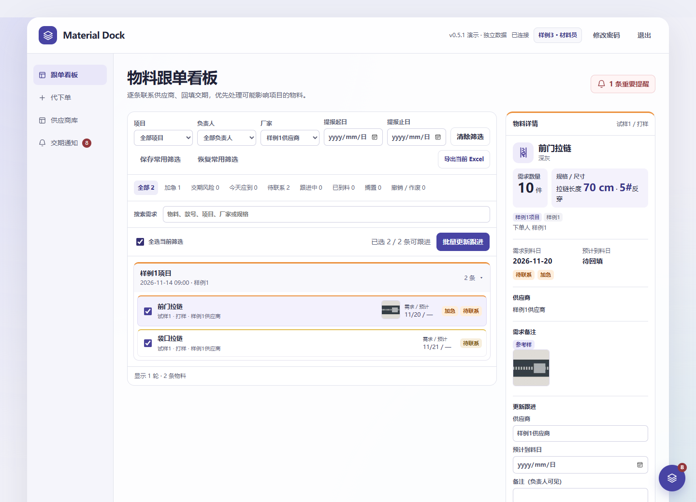

- **One item.** Select it and enter the supplier, estimated date, and update in **更新跟进**. Select **保存跟进并通知**. Give a reason when changing a previously recorded estimate.
- **Several items.** Filter and tick the eligible rows, or choose **全选当前筛选**. Select **批量更新跟进**, enter an update, and save. A blank supplier or estimated date keeps the existing value.
- **Export.** **导出当前 Excel** follows the board filters and search; checkboxes are for batch follow-up. Open the original files in the details panel.

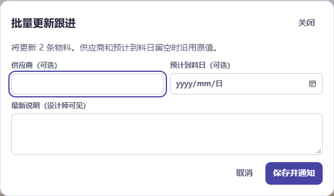

### Record a delivery

Select **登记收货**, enter the quantity in this delivery, the receipt date, and any note, then select **保存实收**. Quantities accumulate. Partial receipts show **部分到料**. Once the total meets the requested quantity, the item shows **已到齐**.

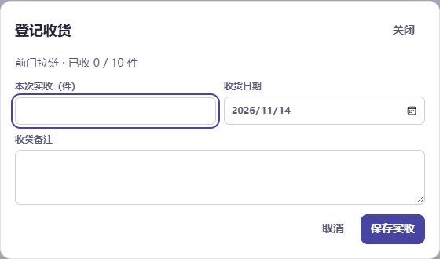

### Order on behalf of a colleague

Open **代下单** and choose **手动代录** or import a workbook. Select the designer so the request appears in their workspace. For requests from other departments, enter the actual requester and follow up from the coordinator’s board. The original submitter remains visible in the details.

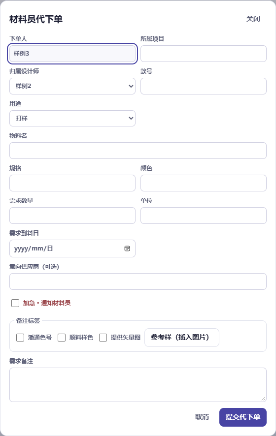

## Supplier directory

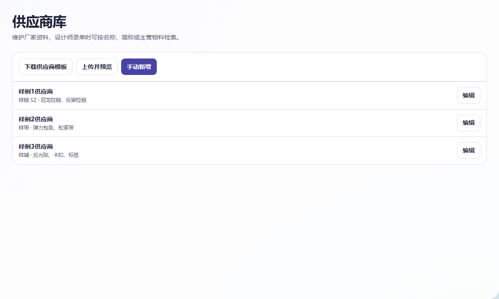

1. Use **下载供应商模板**. The supplier name is required. The alias, product categories, contact details, and notes can be added as needed. Enter phone numbers as text to preserve leading zeroes.
2. Select **上传并预览**. Expand **核对资料** to check the fields. The preview flags duplicates and invalid rows. Select valid rows and confirm with **确认所选入库**.
3. Use **手动新增** to add one supplier, or **编辑** to update an existing one. Designers can search the directory from manual request entry or workbook preview. The coordinator maintains the detailed contact fields.

## Status colors and icons

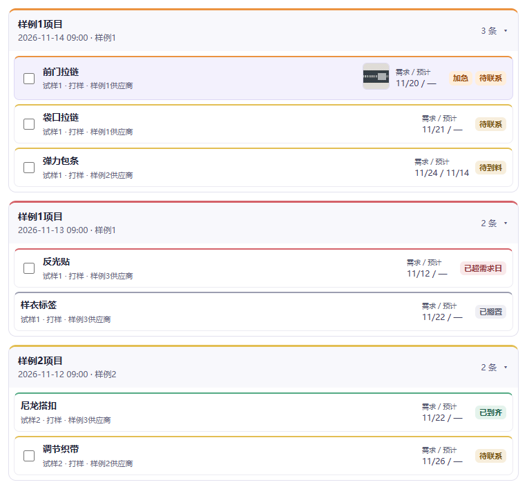

| Color | Meaning |
| --- | --- |
| 🟨 Yellow | Routine work, including waiting to contact, waiting for delivery, and partial receipt. |
| 🟧 Orange | An urgent request still in progress. |
| 🟥 Red | Overdue or expected to arrive late. An urgent item with a delivery risk keeps its urgent badge. |
| 🟩 Green | Received quantity meets the requested quantity. |
| ⬜ Gray | On hold, withdrawn, or voided. Check the text label for the exact state. |

The slim color strip appears on group cards, item rows, and details. Expand a group to see individual states. Solid purple buttons advance or save an action; outlined controls cover actions such as filtering and editing. A disabled button indicates that required inputs or selections are missing.

| Icon | Meaning |
| --- | --- |
| Stacked layers | The Material Dock mark. In the lower-right corner it opens shortcuts. |
| Panel outline | Request board, tracking board, or supplier directory. |
| Plus | New request or order on behalf of another person. |
| Bell | Delivery notices. The number shows unread notices; important items also carry a label. |
|     | The details panel uses a material icon for zippers, strips and webbing, fasteners, or tags. Fabric and sewing thread also have icons. Other materials get a generic box. |

## Notifications and the floating Dock

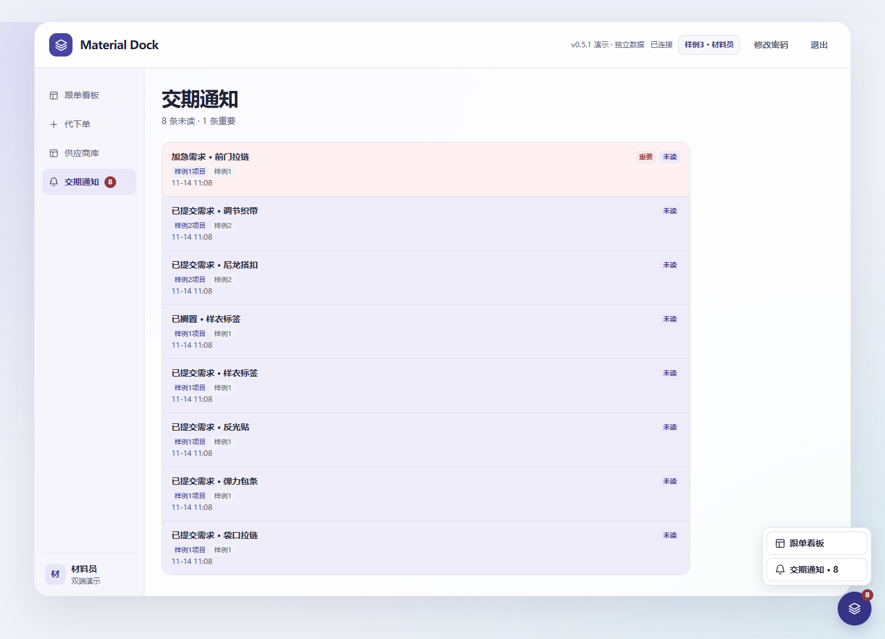

Open **交期通知** for urgent requests, delivery-date updates, and completed receipts. Selecting a notice marks it read and opens the relevant item. The floating layers button at the lower right opens shortcuts to the most common page and notices. The coordinator’s **重要提醒** button also opens the list.
