# Material Dock 图解使用手册

[English](user-guide.en.md) · [返回首页](../README.md)

截图来自 v0.5.1 的本地演示，使用「样例1」等模拟账号和资料。可以照着演示走一遍，再把同样的步骤用到工作里。

## 登录和角色

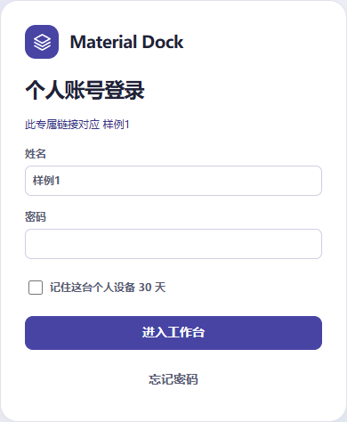

1. 打开自己的专属链接。页面会显示链接对应的姓名，输入当前 Dock 密码后点「进入工作台」。试用密码见本地 [README](../README.md#本地试用)。
2. 公网入口如果先弹出浏览器验证，先用网关凭据通过验证，再回到上图用个人 Dock 账号登录。[公网部署链路](deployment.md#公网部署链路)
3. 自己的设备可勾选「记住这台个人设备 30 天」。共用电脑用完点右上角「退出」。忘记密码时，从自己的专属邀请打开「忘记密码」。

| 角色 | 左侧常用入口 | 能看到什么 |
| --- | --- | --- |
| 设计师 | 我的需求、新建需求、交期通知 | 自己的需求、进度、附件和通知 |
| 材料员 | 跟单看板、代下单、供应商库、交期通知 | 全部跟单需求、供应商资料和材料员通知 |

## 看板、筛选和详情

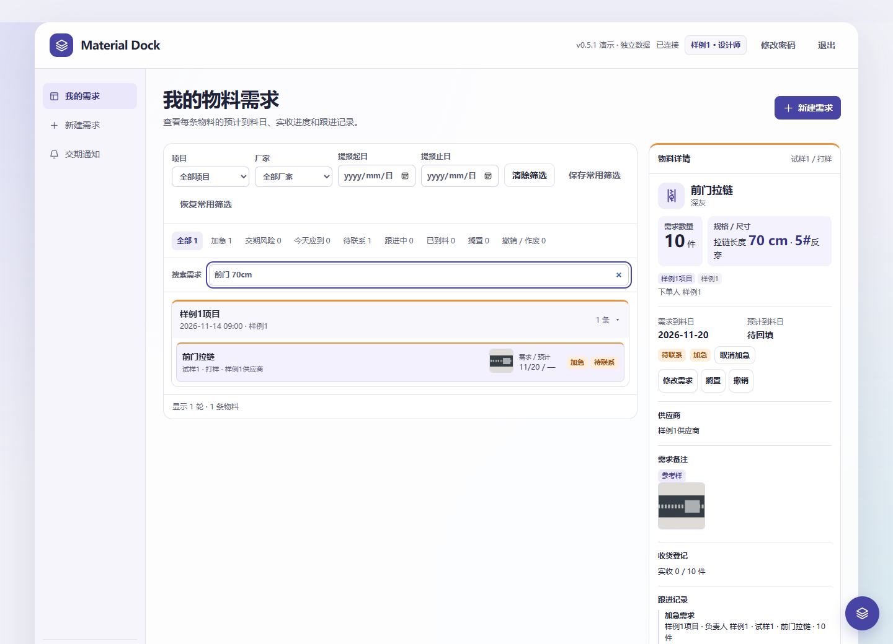

| 区块 | 怎么用 |
| --- | --- |
| 顶栏 | 核对版本、账号和角色。「已连接」表示工作台最近读取成功；「离线 · 上次结果」表示页面还保留上次读取的数据。右侧可「修改密码」和「退出」。 |
| 左侧导航 | 紫色高亮表示当前页。桌面版可同时看到物料列表和右侧详情。 |
| 筛选栏 | 按项目、厂家、提报日期范围筛选，材料员还能按负责人筛选。用「保存常用筛选」记住一套组合，「恢复常用筛选」在本浏览器重新应用，「清除筛选」回到默认视图。 |
| 状态标签与搜索 | 「交期风险」看超期与预计延误，「今天应到」看今天预计到料的未完成项，缺少预计日时按需求日。「跟进中」包括待到料和部分到料。「已到料」查看已到齐项，「撤销 / 作废」查看归档。搜索可叠加在这些条件上，例如 `前门 70cm`。 |
| 需求叠签 | 一次 Excel 提报是一轮，单条手工提报也是一轮。点击项目卡片标题可折叠或展开。标题下是提报时间和人员，右侧条数随当前筛选变化。 |
| 物料行 | 显示物料、款号、用途、厂家、需求日 / 预计日和状态。点击物料名看详情，点小图看原图。 |
| 物料详情 | 数量与单位、数字规格在上方。往下依次核对项目和人员、需求到料日与预计到料日、厂家、备注附件、累计实收，以及 Excel 来源与跟进记录。 |

## 设计师提报和变更

### 一条需求怎么下？

进「新建需求」。用「快速录入」手填一条，或用「粘贴一行」从 Excel 复制一行后按页面列序核对。「填入测试物料」可体验表单。

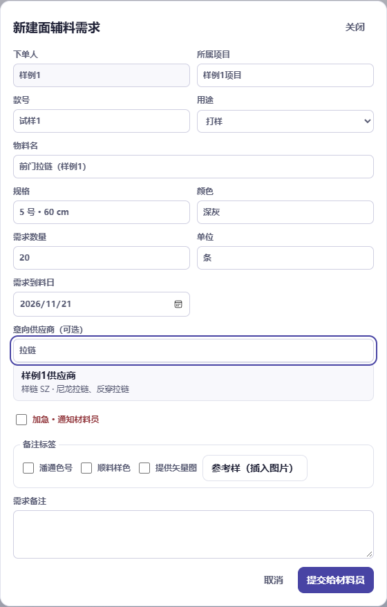

1. 填项目、款号、用途、物料名、数量、单位和需求到料日。设计师的下单人来自登录账号。
2. 按需填规格和颜色。意向供应商可用名称、简称或主营物料搜索，选中库里的一家，也可直接输入库外名称。
3. 紧急需求勾选「加急 · 通知材料员」。颜色和工艺要求可以用「潘通色号」「顺料样色」「提供矢量图」和「参考样（插入图片）」补充。
4. 点「提交给材料员」，回「我的需求」看数据和后续进度。

### 一张表怎么导入？

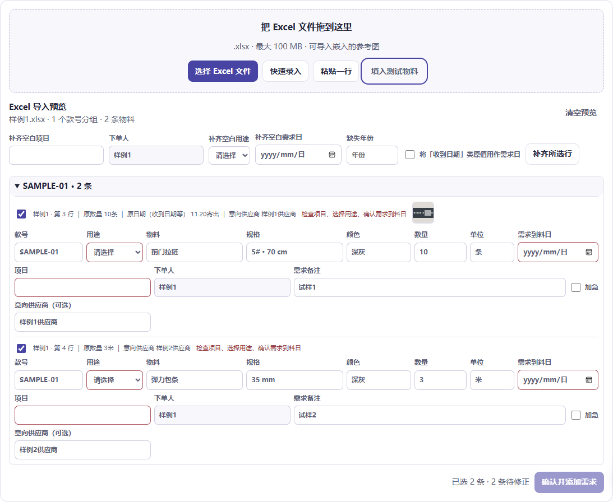

1. 拖入或选择一个 `.xlsx`。上限 100 MB，每批最多 1,000 条。
2. 对照工作表、来源行、原数量和小图，取消勾选不需要的行。带图片引用但图片没有嵌入时，按报错位置重新插图再导入；普通无图行可照常填写。
3. 项目、用途和需求到料日相同的，可以先填在批量补全区，再点「补齐所选行」。它会补空白项。像「11.20 寄出」这样的原备注需要人工确认实际需求到料日。
4. 红框字段填齐后点「确认并添加需求」。提交的行会归进同一轮需求。

### 项目改了怎么办？

尚未登记实收的物料，可在详情用「修改需求」更新数量、日期等并填写原因。暂未决定的点「搁置」，后续点「重新激活」。取消的点「撤销」，仍可从归档恢复。决定终止的已搁置或已撤销项可「作废」，记录和原因会留在归档。

## 材料员跟单和收货

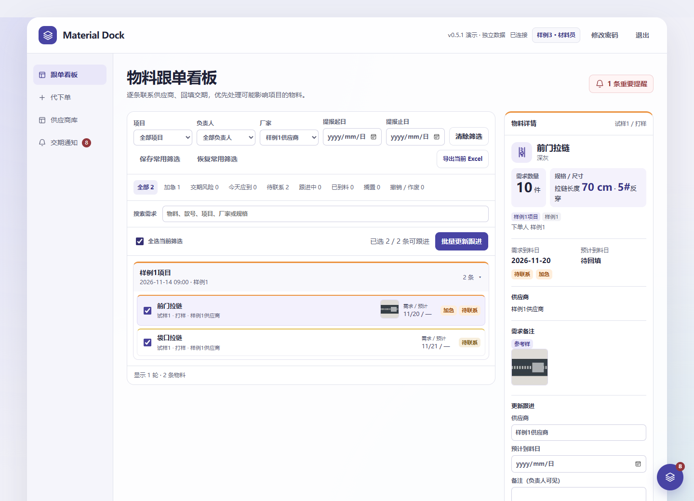

- **回一条交期**。选中物料，在右侧「更新跟进」填写供应商、预计到料日和说明，点「保存跟进并通知」。已回填的预计到料日再次变更时要填原因。
- **一起回多条**。先筛项目、厂家或搜索关键词，再逐条勾选或点「全选当前筛选」。勾选范围是当前可跟进的物料。点「批量更新跟进」，填「最新说明」再保存通知；供应商或预计到料日留空时保留原值。
- **导出当前结果**。「导出当前 Excel」按当前条件导出物料记录。勾选框用于批量跟进。原图和附件仍在工作台详情打开。

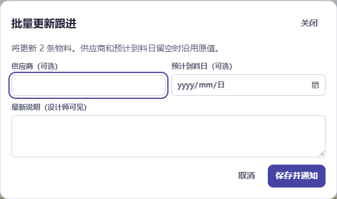

### 分批到货怎么记？

在详情点「登记收货」，填**本次**实收量、日期和可选备注，再点「保存实收」。累计数量会更新。未到齐时进入「部分到料」，累计达到需求量后显示「已到齐」。

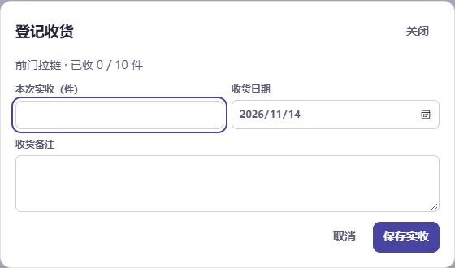

### 同事不在电脑旁怎么办？

进「代下单」，可用「手动代录」或 Excel 导入。在归属设计师里选对方，需求会出现在对方的个人看板。给其他部门代录时，填写实际需求人，由材料员跟进。详情保留实际提报人。

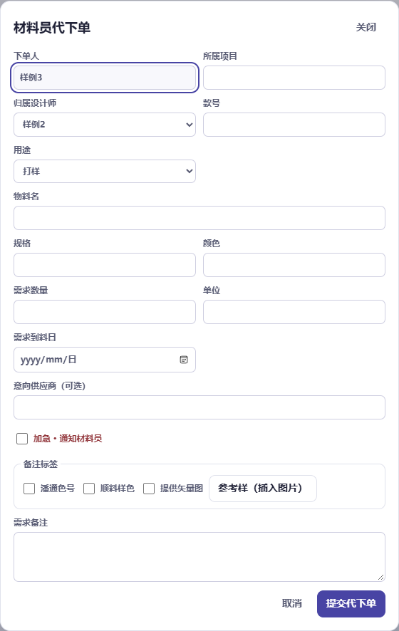

## 供应商库和录单选厂

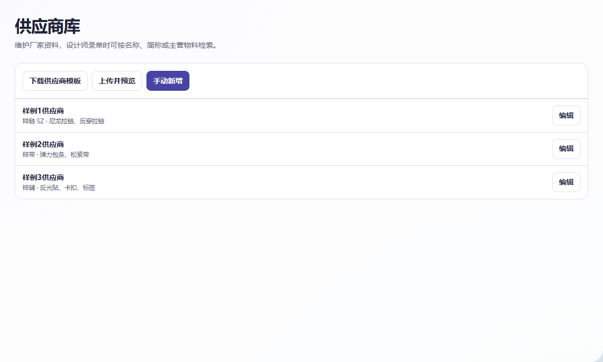

1. 点「下载供应商模板」，填写供应商名称、简称、主营物料、联系方式和备注。「供应商名称」必填，电话列按文本保留区号和前导零。
2. 点「上传并预览」，展开「核对资料」检查每行。重名或缺项会提示，勾选有效行后点「确认所选入库」。
3. 单家可用「手动新增」，已入库资料可点「编辑」。设计师的快速录入和 Excel 预览都能搜索库内名称、简称和主营物料；联系方式等明细由材料员维护。

## 状态色和图标

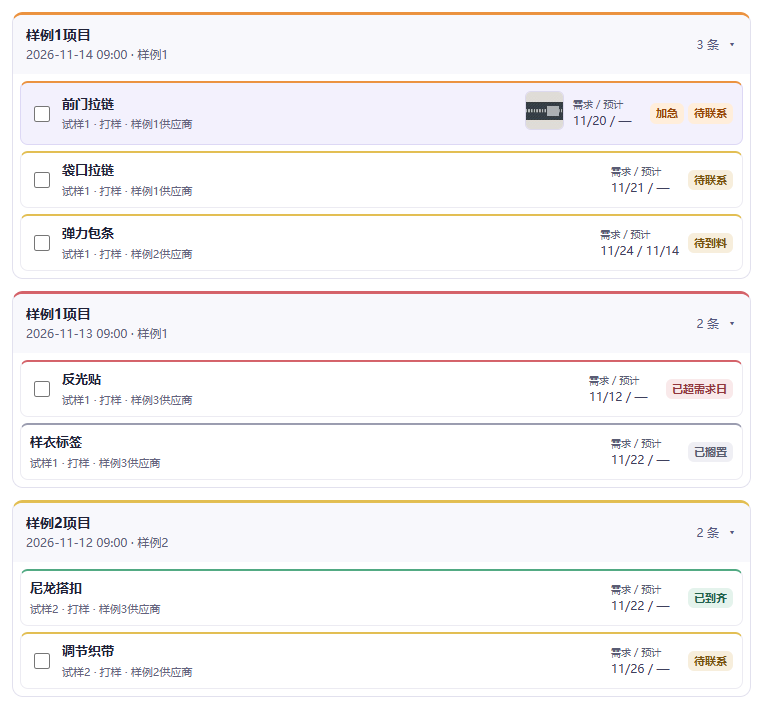

| 状态色 | 怎么读 |
| --- | --- |
| 🟨 黄色 | 普通在办项，包括待联系、待到料和部分到料。 |
| 🟧 橘色 | 加急且仍在跟进。 |
| 🟥 红色 | 已超需求日或预计延误。加急项同时有风险时用红色，并保留「加急」标签。 |
| 🟩 绿色 | 累计实收达到需求量，已到齐。 |
| ⬜ 灰色 | 已搁置、撤销或作废。结合文字标签区分。 |

颜色显示在叠签、物料行和详情的窄边上；项目有多项物料时，可展开逐条看状态。紫色实心按钮用于继续或保存，描边按钮用于筛选、编辑和其他操作，禁用态表示当前条件还不满足。

| 图标 | 用途 |
| --- | --- |
| 叠层线条 | Material Dock 标识，放在右下角时是快捷入口。 |
| 方框面板 | 进入需求看板、跟单看板或供应商库。 |
| 加号 | 新建需求或代下单。 |
| 铃铛 | 交期通知，数字表示未读数量，重要提醒另有标签。 |
|     | 详情按物料名显示拉链、织带 / 胶条、扣件、吊牌等图标。面料和缝纫线也有对应图标，其余显示通用箱子。 |

## 通知和悬浮快捷入口

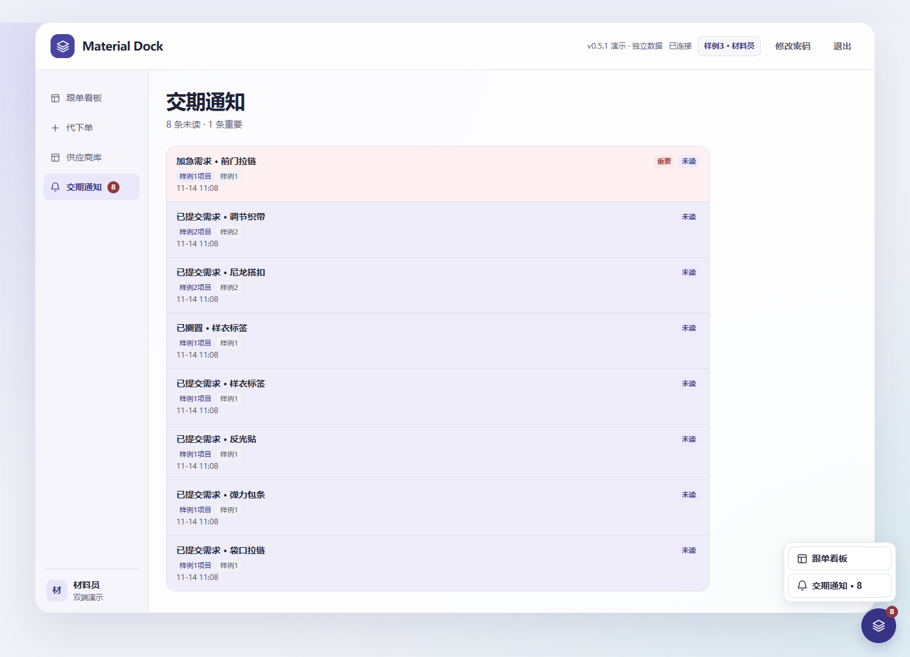

「交期通知」列出需要关注的事项，例如加急需求、交期更新和到齐消息。点某条通知会跳到物料并标记已读。右下角叠层圆形按钮可以展开快捷菜单，切换到常用页或通知。材料员看板上的「重要提醒」也可直接进入通知列表。
